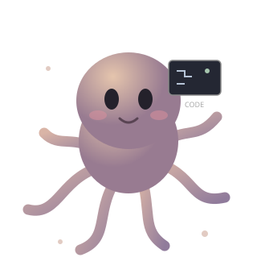

 

  
  

 

<table>
<tr>
<td width="65%" valign="middle">

## A little about me.

I'm **Harsh Pandit**, a vibe coder who loves turning ideas into digital experiences.

I enjoy building websites, desktop applications, and experimenting with AI-powered tools. I like exploring new technologies, breaking things, figuring out how they work, and turning random ideas into something real.

For me, coding isn't just about writing lines of code. It's about imagination, experimentation, and creating things that people enjoy using.

**Currently interested in:**

- Building beautiful websites and applications.
- AI-powered development and coding agents.
- Exploring open-source software.
- Minimal UI, smooth animations, and great UX.
- Learning new technologies by building projects.

*Think it. Build it. Make it better.*

</td>
<td width="35%" align="center" valign="middle">

Just another day in the code ocean.

</td>
</tr>
</table>

---

## Technologies & Tools

## What I enjoy

**01 / BUILD**

Turning random ideas into working products.

**02 / EXPLORE**

Discovering technologies, tools, and possibilities.

**03 / EXPERIMENT**

Playing with AI and finding new ways to create.

---

## Let's connect.

<a href="https://github.com/harshpandit47dev">GitHub</a> &nbsp; · &nbsp; <a href="https://x.com/Harsh_dev47">X / Twitter</a>

 

*Made with curiosity, coffee, and a little bit of code.*

